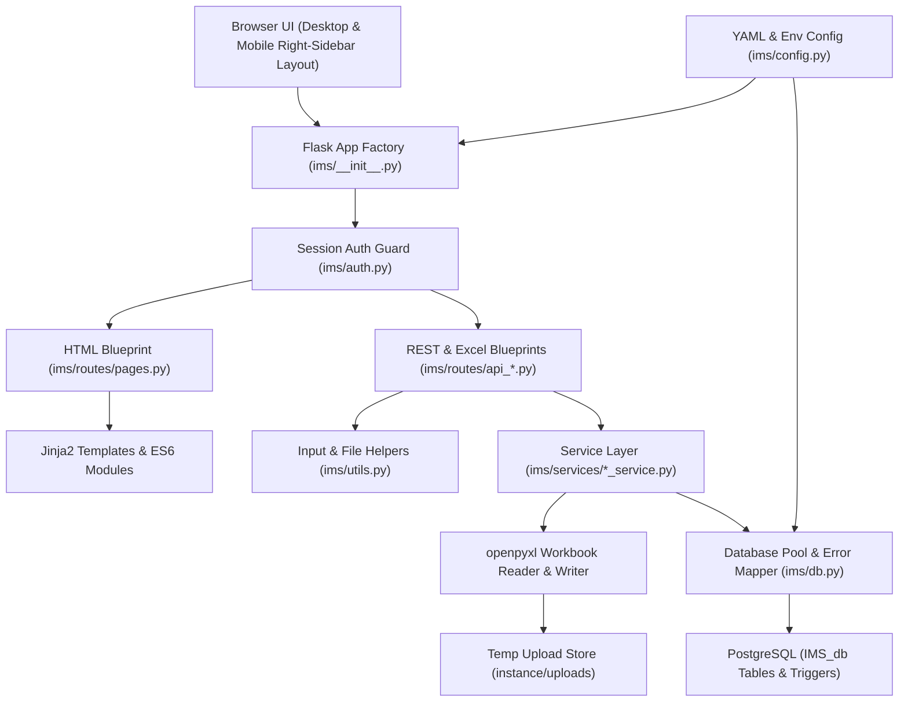
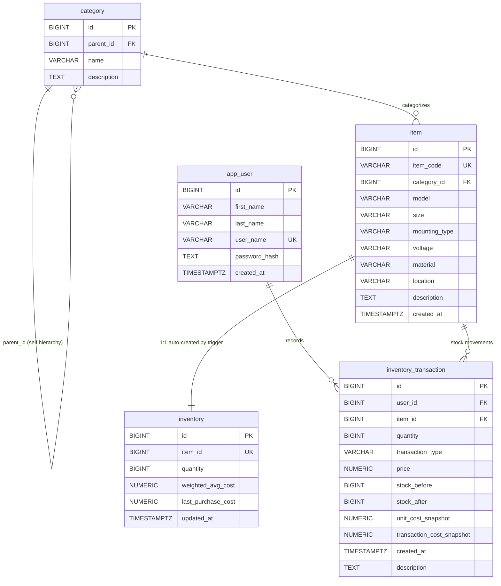

# Inventory Management System (IMS) — Architecture & Reference

This document describes the system topology, database architecture and ERD, business logic, core infrastructure modules, HTTP routes, and service layer of the Inventory Management System (IMS).

---

## 1. System Topology & Architecture Overview

IMS is a modular Flask + PostgreSQL web application with a Vanilla ES6 / CSS responsive frontend (no Node.js build pipeline required). Business logic is decoupled from HTTP request handling, and stock/valuation integrity is enforced directly by PostgreSQL constraints and triggers.

### Repository Layout

```text
IMS/
├── run.py                          # Application entry point (starts Flask on IMS_HOST:IMS_PORT)
├── database_init.py                # PostgreSQL database, schema, index, trigger, and seed initializer
├── db_config.yaml                  # Default PostgreSQL connection settings (IMS_db)
├── requirements.txt                # Python dependencies (Flask, psycopg2-binary, PyYAML, openpyxl)
├── data/
│   └── sample_data.xlsx            # Sample 10-item initial inventory workbook
├── docs/
│   ├── ARCHITECTURE.md             # This architecture reference
│   └── data base desgin/
│       └── IMS_ERD_V-0.1.drawio.png
├── tests/
│   └── test_ims.py                 # End-to-end integration tests against isolated IMS_test_db
└── ims/
    ├── __init__.py                 # create_app() factory, JSON provider, global error handlers
    ├── config.py                   # YAML/env DB config and Flask secret/upload config
    ├── db.py                       # ThreadedConnectionPool wrapper, AppError, PG error translation
    ├── auth.py                     # Session auth, login_required decorator, password helpers
    ├── utils.py                    # Input parsing/normalization and .xlsx upload lifecycle helpers
    ├── routes/                     # Flask Blueprints (HTML pages + REST JSON / Excel APIs)
    ├── services/                   # Domain logic, SQL queries, Excel import/BOM/export engines
    ├── templates/                  # Jinja2 HTML pages extending base.html (right-aligned sidebar)
    └── static/                     # Modular CSS design system and ES6 page/UI JS modules
```

### Request & Data Flow Topology



---

## 2. Database Architecture & ERD

The primary schema reference is [database_init.py](file:///e:/works/YaraSystem/IMS%20-%20inventory%20management%20system/IMS/database_init.py) (alongside the visual diagram at [IMS_ERD_V-0.1.drawio.png](file:///e:/works/YaraSystem/IMS%20-%20inventory%20management%20system/IMS/docs/data%20base%20desgin/IMS_ERD_V-0.1.drawio.png)).

### Entity-Relationship Diagram



### Exact Table Constraints & Precision Highlights

- **`app_user`**: `user_name VARCHAR(80) UNIQUE NOT NULL`, `password_hash TEXT NOT NULL`.
- **`category`**: Self-referencing `parent_id` with `ON UPDATE RESTRICT ON DELETE RESTRICT` and `CHECK (parent_id IS NULL OR parent_id <> id)`.
- **`item`**: `item_code VARCHAR(80) UNIQUE NOT NULL`, `model VARCHAR(150) NOT NULL`, `location VARCHAR(150) NOT NULL`, `mounting_type VARCHAR(10) NULL` constrained to `'SMD'` or `'DIP'`, `category_id` FK (`ON DELETE RESTRICT`).
- **`inventory`**: `item_id BIGINT UNIQUE NOT NULL` (`ON DELETE RESTRICT`), `quantity BIGINT DEFAULT 0 CHECK (quantity >= 0)`, `weighted_avg_cost NUMERIC(18,4) NULL CHECK (>= 0)`, `last_purchase_cost NUMERIC(18,4) NULL CHECK (>= 0)`.
- **`inventory_transaction`**: `quantity BIGINT CHECK (quantity > 0)`, `price NUMERIC(18,4) NULL`, `unit_cost_snapshot NUMERIC(18,4) NULL`, `transaction_cost_snapshot NUMERIC(24,4) GENERATED ALWAYS AS (quantity::NUMERIC * unit_cost_snapshot) STORED`, stock direction & non-negative checks, and `chk_transaction_price_by_type`.

### PostgreSQL Triggers (`database_init.py`)

| Trigger Name | Event | Trigger Function | Responsibility |
| :--- | :--- | :--- | :--- |
| `trg_create_inventory_for_item` | `AFTER INSERT ON item` | `fn_create_inventory_for_item()` | Inserts matching `inventory(quantity=0, weighted_avg_cost=NULL, last_purchase_cost=NULL)` row. |
| `trg_prepare_inventory_transaction` | `BEFORE INSERT ON inventory_transaction` | `fn_prepare_inventory_transaction()` | Validates type/qty/price, locks `inventory` via `SELECT ... FOR UPDATE`, blocks negative stock, sets `stock_before`, `stock_after`, `unit_cost_snapshot`, and `created_at`. |
| `trg_apply_inventory_transaction` | `AFTER INSERT ON inventory_transaction` | `fn_apply_inventory_transaction()` | Updates `inventory.quantity`, recomputes `weighted_avg_cost`, updates `last_purchase_cost` on `PURCHASE_IN` or priced `OPENING`, and refreshes `updated_at`. |
| `trg_prevent_transaction_update` / `trg_prevent_transaction_delete` | `BEFORE UPDATE` / `BEFORE DELETE ON inventory_transaction` | `fn_prevent_transaction_mutation()` | Raises an exception so historical transactions remain strictly immutable. |
| `trg_validate_category_hierarchy` | `BEFORE INSERT OR UPDATE OF parent_id ON category` | `fn_validate_category_hierarchy()` | Uses a recursive CTE over ancestors to reject circular hierarchies (`A -> B -> A`). |

---

## 3. Core Business Logic

### Items vs. Inventory & Immutable Ledger
- **Separation of concerns**: `item` stores component specifications and physical storage location; `inventory` stores live quantity and cost state. Application code never inserts, updates, or deletes `inventory` directly and never updates/deletes `inventory_transaction`.
- **Single source of stock truth**: Every stock movement is recorded as a new row in `inventory_transaction` with positive `quantity > 0`.

### Transaction Types, Pricing & Cost Calculations

| Transaction Type | Stock Direction | `price` Rule | `unit_cost_snapshot` | Effect on `weighted_avg_cost` | Effect on `last_purchase_cost` |
| :--- | :--- | :--- | :--- | :--- | :--- |
| `OPENING` | `+quantity` | Optional (`>= 0`) | `COALESCE(price, current_wac)` | Recalculated if `price` given | Updated to `price` if `price IS NOT NULL` |
| `PURCHASE_IN` | `+quantity` | **Required** (`>= 0`) | `price` | Recalculated weighted average | Updated to `price` |
| `ADJUSTMENT_IN` | `+quantity` | Optional (`>= 0`) | `COALESCE(price, current_wac)` | Recalculated if `price` given | Unchanged |
| `OUT` | `-quantity` | Must be `NULL` | `current_wac` | Retained (even when stock hits `0`) | Unchanged |
| `ADJUSTMENT_OUT` | `-quantity` | Must be `NULL` | `current_wac` | Retained (even when stock hits `0`) | Unchanged |

Weighted Average Cost (`fn_apply_inventory_transaction`) rules when incoming `price IS NOT NULL`:
1. If `stock_before = 0`: `new_wac = price`.
2. Else if `old_wac IS NOT NULL`: `new_wac = ((stock_before * old_wac) + (quantity * price)) / stock_after`.
3. Else (`stock_before > 0` and `old_wac IS NULL`): `new_wac` stays `NULL` (existing unpriced stock prevents inventing an inaccurate WAC).

### Shopping-Cart Bulk Transactions
- Duplicate `item_id` rows in a cart submission are aggregated (`sum(quantity)`) before hitting the database so duplicate rows cannot bypass stock checks. Conflicting unit prices across duplicate rows for the same component are flagged and rejected.
- Each distinct `item_id` runs inside its own PostgreSQL transaction (`with db.transaction():`) while `trg_prepare_inventory_transaction` holds a row lock (`SELECT ... FOR UPDATE`). If one component has insufficient stock, only that component fails; all other valid components commit cleanly and every item's outcome is reported individually.

### Initial Inventory Excel Import
1. **Upload & Inspect**: Saves `.xlsx` temporarily in `instance/uploads/`, reads sheet names/headers, and auto-suggests column mappings.
2. **Dry-Run Preview**: Validates required fields (`item_code`, `category`, `model`, `location`, `quantity`), normalizes `mounting_type` (`SMD`/`DIP`), flags duplicate `item_code`s within the workbook, checks existing items and `OPENING` history in PostgreSQL, and previews which main categories and subcategories will be created.
3. **Confirm Execution**:
   - **Step A**: Scans valid rows' `category` and `sub_category` columns and populates unique parent (`parent_id IS NULL`) and child (`parent_id = parent.id`) rows in `category` first.
   - **Step B**: Inserts each new item into `item` (auto-creating `inventory`) and, if `quantity > 0`, inserts an `OPENING` transaction (populating stock, `weighted_avg_cost`, and `last_purchase_cost` via triggers). Zero-quantity items are created with `quantity = 0` without inserting a `0`-quantity transaction.
   - Existing items follow the chosen policy: `skip` (default — zero changes) or `update_metadata` (updates `item` specification columns only; never touches `inventory` or `OPENING` records).

### Read-Only BOM Cost Calculator
- Strictly read-only: never modifies `item`, `inventory`, or `inventory_transaction`.
- Separates invalid rows (missing code or non-positive/non-integer quantity) and merges duplicate `item_code`s.
- Classifies each unique component as `Available`, `Insufficient` (with shortage), `Out of Stock`, or `Unknown`.
- Uses `Decimal` arithmetic to compute line and grand totals under both **Weighted Average Cost** and **Last Purchase Cost**. If any BOM component is unknown or has a `NULL` unit cost, that price is never treated as `0`; the grand total is marked `Incomplete` alongside the known-cost subtotal and missing item count.

### Dashboard & Valuations
- Displays distinct items, total physical stock units, zero-stock count, incoming/outgoing transaction counts, recent movements, recently added items, and WAC / Last Purchase total valuations (each flagged `Incomplete` whenever any stocked item has `NULL` cost). No low-stock field or KPI metric is included.

---

## 4. Core Infrastructure Modules (`ims/`)

- **[ims/__init__.py](file:///e:/works/YaraSystem/IMS%20-%20inventory%20management%20system/IMS/ims/__init__.py)**  
  **Purpose:** Flask application factory and global request/response wiring.  
  **What it does:** Defines `ImsJsonProvider` (serializing `Decimal` as `float` and `datetime`/`date` as ISO 8601), initializes `Database` inside `create_app()`, injects `current_user` into Jinja templates, registers global JSON/HTTP error handlers (`AppError`, `HTTPException`, `500`), and mounts all 9 Blueprints (`pages` + 8 `api_*` modules).

- **[ims/config.py](file:///e:/works/YaraSystem/IMS%20-%20inventory%20management%20system/IMS/ims/config.py)**  
  **Purpose:** Application and PostgreSQL configuration loader.  
  **What it does:** `load_db_config()` reads `db_config.yaml` and applies optional `IMS_DB_*` environment overrides (used by tests to target `IMS_test_db`). `build_flask_config()` ensures `instance/uploads/` exists, configures the 16 MB upload cap and HTTP-only `Lax` session cookies, and resolves `SECRET_KEY` via `IMS_SECRET_KEY` or persistent `instance/secret_key`.

- **[ims/db.py](file:///e:/works/YaraSystem/IMS%20-%20inventory%20management%20system/IMS/ims/db.py)**  
  **Purpose:** PostgreSQL connection pooling, transaction management, and driver error translation.  
  **What it does:** `Database` manages a `psycopg2.pool.ThreadedConnectionPool(2, 20)` using `RealDictCursor`, exposing `connection()`, `cursor(commit=False)`, and `transaction()` context managers with automatic commit/rollback and pool return. Defines `AppError` and `translate_pg_error()`, which maps PostgreSQL exceptions (`RaiseException` from triggers, `UniqueViolation`, `ForeignKeyViolation` + `RestrictViolation` from `ON DELETE RESTRICT`, `CheckViolation`, `NotNullViolation`, `NumericValueOutOfRange`, `StringDataRightTruncation`) into clean HTTP status codes (`400`, `409`, `500`) and readable messages. `get_db()` returns the active pool from `current_app.extensions["db"]`.

- **[ims/auth.py](file:///e:/works/YaraSystem/IMS%20-%20inventory%20management%20system/IMS/ims/auth.py)**  
  **Purpose:** Internal user authentication and session authorization guards.  
  **What it does:** Provides `prepare_password()` (currently returning raw password plaintext per project requirement, isolated in one place for future hashing) and constant-time `verify_password()`. `authenticate_user()` validates credentials against `app_user`. `get_current_user()` caches the active user in `flask.g` from `session["user_id"]` (excluding `password_hash`). `@login_required` protects routes by returning HTTP `401` JSON for `/api/*` paths or redirecting to `/login` for HTML pages.

- **[ims/utils.py](file:///e:/works/YaraSystem/IMS%20-%20inventory%20management%20system/IMS/ims/utils.py)**  
  **Purpose:** Shared input sanitization, numeric/type parsing, and temporary Excel upload utilities.  
  **What it does:** Implements `clean_text()` (normalizes strings and Excel float artifacts like `1001.0`), `normalize_mounting_type()` (`SMD`/`DIP`), strict `parse_positive_int()`, `parse_nonnegative_int()`, `parse_optional_price()` (`Decimal` quantized to 4 decimal places), `parse_optional_int()`, and `parse_bool_param()`. Also manages temporary `.xlsx` uploads via `save_uploaded_xlsx()`, `resolve_uploaded_xlsx()`, and `purge_old_uploads()` (1-hour TTL).

---

## 5. Routes Layer (`ims/routes/`)

All API routes (except `/api/auth/login` and `/api/auth/logout`) require an authenticated session via `@login_required`.

| File | URL Prefix | Endpoints | Aim & Delegated Service |
| :--- | :--- | :--- | :--- |
| [pages.py](file:///e:/works/YaraSystem/IMS%20-%20inventory%20management%20system/IMS/ims/routes/pages.py) | `/` | `GET /login`, `/`, `/inventory`, `/transactions/new`, `/bom`, `/transactions`, `/reports`, `/excel`, `/users` | Serves Jinja2 HTML views for every section of the application (`login.html` redirects if already signed in). |
| [api_auth.py](file:///e:/works/YaraSystem/IMS%20-%20inventory%20management%20system/IMS/ims/routes/api_auth.py) | `/api` | `POST /auth/login`, `POST /auth/logout`, `GET /auth/me`, `GET /users`, `POST /users`, `PUT /users/me/password` | Manages login sessions, lists users with transaction counts, creates users, and updates the current user's password via [ims/auth.py](file:///e:/works/YaraSystem/IMS%20-%20inventory%20management%20system/IMS/ims/auth.py) and `app_user`. |
| [api_categories.py](file:///e:/works/YaraSystem/IMS%20-%20inventory%20management%20system/IMS/ims/routes/api_categories.py) | `/api/categories` | `GET`, `POST`, `PUT /<id>`, `DELETE /<id>` | Exposes flat & nested category tree CRUD via `category_service`. |
| [api_items.py](file:///e:/works/YaraSystem/IMS%20-%20inventory%20management%20system/IMS/ims/routes/api_items.py) | `/api/items` | `GET`, `POST`, `GET /filter-options`, `GET /<id>`, `PUT /<id>` | Handles multi-field paginated component search, filter dropdown options, item detail + history retrieval, and item creation/editing via `item_service`. |
| [api_transactions.py](file:///e:/works/YaraSystem/IMS%20-%20inventory%20management%20system/IMS/ims/routes/api_transactions.py) | `/api/transactions` | `GET`, `POST`, `POST /bulk` | Queries paginated transaction history, submits single-item stock movements, and submits shopping-cart bulk batches under `current_user["id"]` via `transaction_service`. |
| [api_dashboard.py](file:///e:/works/YaraSystem/IMS%20-%20inventory%20management%20system/IMS/ims/routes/api_dashboard.py) | `/api` | `GET /dashboard/summary`, `GET /reports/analytics` | Supplies Dashboard KPIs/recent activity and Reports & Analytics breakdowns via `inventory_service`. |
| [api_import.py](file:///e:/works/YaraSystem/IMS%20-%20inventory%20management%20system/IMS/ims/routes/api_import.py) | `/api/import` | `POST /upload`, `POST /inspect`, `POST /preview`, `POST /confirm` | Orchestrates multi-step `.xlsx` upload, sheet/column inspection, dry-run validation preview, and import execution under `current_user["id"]` via `import_service`. |
| [api_bom.py](file:///e:/works/YaraSystem/IMS%20-%20inventory%20management%20system/IMS/ims/routes/api_bom.py) | `/api/bom` | `POST /inspect`, `POST /calculate`, `POST /export` | Provides read-only BOM upload inspection, availability/dual-cost calculation, and `bom_cost_report.xlsx` download via `bom_service`. |
| [api_export.py](file:///e:/works/YaraSystem/IMS%20-%20inventory%20management%20system/IMS/ims/routes/api_export.py) | `/api/export` | `GET /inventory`, `GET /transactions` | Streams timestamped `.xlsx` files for filtered inventory and movement history reports via `export_service`. |

---

## 6. Services Layer (`ims/services/`)

- **[category_service.py](file:///e:/works/YaraSystem/IMS%20-%20inventory%20management%20system/IMS/ims/services/category_service.py)**  
  **Aim:** Manage hierarchical `category` records.  
  **Responsibilities:** Queries flat and nested category trees (`list_categories`, `get_category_tree`) using recursive CTEs for `full_path`, `depth`, direct item counts, and subtree item counts; creates/updates/deletes categories while checking case-insensitive sibling uniqueness and letting PostgreSQL enforce cycle and foreign-key restrictions; provides `resolve_or_create_category_pair()` for Excel import category population.

- **[item_service.py](file:///e:/works/YaraSystem/IMS%20-%20inventory%20management%20system/IMS/ims/services/item_service.py)**  
  **Aim:** Manage `item` specifications and unified inventory search across the application.  
  **Responsibilities:** Defines `CAT_INFO_CTE` and `build_inventory_filter_sql()` (combining general search, item attributes, recursive category/subcategory matching, quantity ranges, zero stock, below-threshold `< N`, and WAC/LPC ranges). Implements server-side paginated/sorted `list_items()`, `get_item_detail()` (joining item specs, live `inventory`, and recent `inventory_transaction` history), `create_item()`, `update_item()`, and `get_filter_options()`.

- **[transaction_service.py](file:///e:/works/YaraSystem/IMS%20-%20inventory%20management%20system/IMS/ims/services/transaction_service.py)**  
  **Aim:** Record validated stock movements and query the immutable transaction ledger.  
  **Responsibilities:** Validates transaction types, positive integer quantities, and price constraints (`_validate_tx_inputs`). `process_single_transaction()` inserts into `inventory_transaction` within its own DB transaction and returns the trigger-populated transaction and updated `inventory` row. `submit_cart_transactions()` aggregates duplicate `item_id` cart rows and processes each distinct component independently for per-item success/failure reporting. `list_transactions()` and `build_transaction_filter_sql()` serve filtered movement history and exports.

- **[inventory_service.py](file:///e:/works/YaraSystem/IMS%20-%20inventory%20management%20system/IMS/ims/services/inventory_service.py)**  
  **Aim:** Compute read-only Dashboard KPIs and inventory/movement analytics.  
  **Responsibilities:** `get_dashboard_summary()` aggregates total distinct items, total units, zero-stock count, WAC and Last Purchase valuations (reporting missing-cost counts and completeness flags), incoming/outgoing transaction counts, latest 10 movements, and latest 8 items. `get_analytics()` produces category/subcategory valuation breakdowns and date-filtered movement totals by transaction type.

- **[import_service.py](file:///e:/works/YaraSystem/IMS%20-%20inventory%20management%20system/IMS/ims/services/import_service.py)**  
  **Aim:** Import initial component catalogs and stock safely from Excel workbooks.  
  **Responsibilities:** Reads `.xlsx` files via `openpyxl` (`inspect_import_upload`), suggests column mappings, performs full dry-run validation and category resolution planning (`preview_import`), and executes `confirm_import()` by populating unique categories/subcategories in `category` first, then creating items and recording initial positive stock via `OPENING` transactions while respecting `skip` or `update_metadata` policies.

- **[bom_service.py](file:///e:/works/YaraSystem/IMS%20-%20inventory%20management%20system/IMS/ims/services/bom_service.py)**  
  **Aim:** Read-only BOM availability analysis and dual-method cost calculation.  
  **Responsibilities:** Inspects BOM Excel headers (`inspect_bom_upload`), aggregates duplicate `item_code`s and isolates invalid rows (`calculate_bom`), evaluates availability against `inventory`, calculates exact `Decimal` WAC and Last Purchase costs without treating missing prices as zero, and generates a 3-sheet styled workbook (`export_bom_report_xlsx`).

- **[export_service.py](file:///e:/works/YaraSystem/IMS%20-%20inventory%20management%20system/IMS/ims/services/export_service.py)**  
  **Aim:** Generate formatted `.xlsx` reports for inventory and stock movements.  
  **Responsibilities:** `export_inventory_xlsx()` and `export_transactions_xlsx()` reuse `item_service.list_items(..., paginate=False)` and `transaction_service.list_transactions(..., paginate=False)`, format numeric columns, append inventory valuation summary rows (flagging incomplete valuations when any stocked item has `NULL` cost), and return `.xlsx` bytes.
