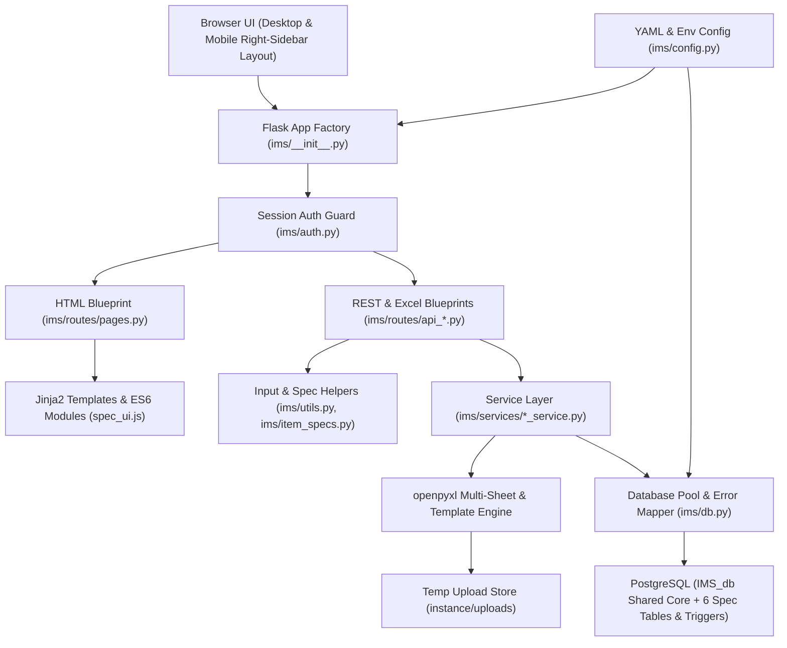
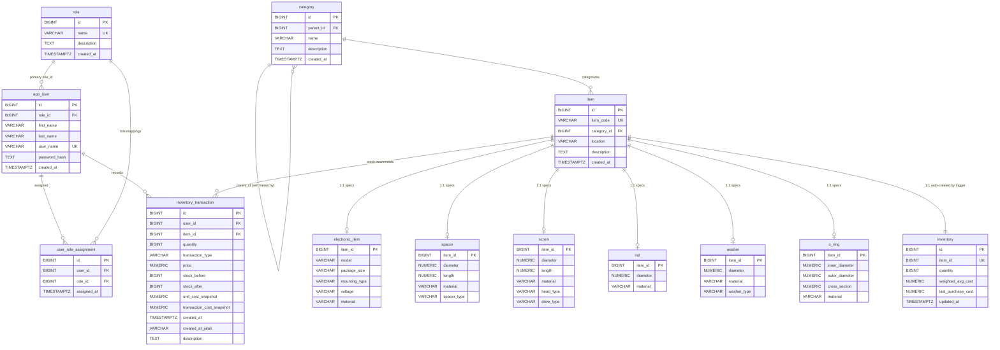

# Inventory Management System (IMS) — Architecture & Reference

This document describes the system topology, multi-table item specification database architecture and ERD, business logic, core infrastructure modules, HTTP routes, and service layer of the Inventory Management System (IMS).

---

## 1. System Topology & Architecture Overview

IMS is a modular Flask + PostgreSQL web application with a Vanilla ES6 / CSS responsive frontend (no Node.js build pipeline required). Business logic is decoupled from HTTP request handling, and stock, valuation, and item-specification consistency are enforced directly by PostgreSQL constraints and triggers.

### Repository Layout

```text
IMS/
├── run.py                          # Application entry point (starts Flask on IMS_HOST:IMS_PORT)
├── database_init.py                # PostgreSQL database, multi-table schema, triggers, and seed initializer
├── db_config.yaml                  # Default PostgreSQL connection settings (IMS_db)
├── requirements.txt                # Python dependencies (Flask, psycopg2-binary, PyYAML, openpyxl)
├── data/
│   └── sample_data.xlsx            # Sample 10-item initial electronic inventory workbook
├── docs/
│   ├── ARCHITECTURE.md             # This architecture reference
│   └── data base desgin/
│       └── IMS_ERD_V-0.1.drawio.png
├── tests/
│   └── test_ims.py                 # End-to-end integration tests against isolated IMS_test_db
└── ims/
    ├── __init__.py                 # create_app() factory, JSON provider, global error handlers
    ├── config.py                   # YAML/env DB config and Flask secret/upload config
    ├── db.py                       # ThreadedConnectionPool wrapper, AppError, PG error translation
    ├── auth.py                     # Session auth, login_required decorator, role helpers
    ├── item_specs.py               # Centralized spec definitions, mm validation, Farsi labels, formatting
    ├── jalali.py                   # Jalali calendar formatting & Tehran-timezone filtering helpers
    ├── utils.py                    # Input normalization, mm/integer/price parsing, .xlsx upload helpers
    ├── routes/                     # Flask Blueprints (HTML pages + REST JSON / Excel APIs)
    ├── services/                   # Domain logic, SQL queries, multi-type Excel import/BOM/export engines
    ├── templates/                  # Jinja2 HTML pages extending base.html (right-aligned sidebar)
    └── static/                     # Modular CSS design system and ES6 page/spec_ui JS modules
```

### Request & Data Flow Topology



---

## 2. Multi-Table Database Architecture & ERD

The primary schema reference is [database_init.py](file:///e:/works/YaraSystem/IMS%20-%20inventory%20management%20system/IMS/database_init.py). The `item` table holds shared component metadata (`id`, `item_code`, `category_id`, `location`, `description`, `created_at`), while type-specific technical attributes live in six strict `1:1` specification tables (`ON DELETE CASCADE`, `ON UPDATE RESTRICT`) keyed by `item_id` as `PRIMARY KEY`:

- **`electronic_item`** (`Electronic > *`): `model` (nullable), `package_size`, `mounting_type` (`SMD`/`DIP`), `voltage`, `material`.
- **`spacer`** (`Mechanical > Spacer`): `diameter` (`NUMERIC(10,3) > 0`), `length` (`NUMERIC(10,3) > 0`), `material` (`STAINLESS_STEEL`/`PLASTIC`), `spacer_type` (`F`/`H`).
- **`screw`** (`Mechanical > Screw`): `diameter`, `length`, `material` (`STAINLESS_STEEL`/`BLACK`/`WHITE`), `head_type` (`سرخزینه`, `آلنی`, `قارچی`, `مغزی`), `drive_type` (`چهارسو`, `آلنی`).
- **`nut`** (`Mechanical > Nut`): `diameter`, `material` (`STAINLESS_STEEL`/`IRON`).
- **`washer`** (`Mechanical > Washer`): `diameter`, `material` (`PAPER`/`STAINLESS_STEEL`/`IRON`), `washer_type` (`PLAIN`/`SPRING`).
- **`o_ring`** (`Mechanical > O-Ring`): `inner_diameter`, `outer_diameter` (`CHECK (outer_diameter > inner_diameter)`), `cross_section NUMERIC(10,3) GENERATED ALWAYS AS ((outer_diameter - inner_diameter) / 2) STORED`, `material` (`NBR`/`VITON`/`SILICONE`).

### Entity-Relationship Diagram



### Seeded Categories (`seed_initial_data`)
- **`Electronic`**: `Resistor`, `Capacitor`, `Diode`, `Relay`, `Microcontroller`, `Other electronic components`.
- **`Mechanical`**: `Spacer`, `Screw`, `Nut`, `Washer`, `O-Ring`.

### PostgreSQL Triggers (`database_init.py`)

| Trigger Name | Event | Trigger Function | Responsibility |
| :--- | :--- | :--- | :--- |
| `trg_create_inventory_for_item` | `AFTER INSERT ON item` | `fn_create_inventory_for_item()` | Inserts matching `inventory(quantity=0, weighted_avg_cost=NULL, last_purchase_cost=NULL)` row. |
| `trg_validate_item_category` | `BEFORE INSERT OR UPDATE OF category_id ON item` | `fn_validate_item_category()` | Ensures `item.category_id` maps cleanly to a valid leaf spec type and prevents incompatible category moves when a spec row exists. |
| `trg_validate_*_spec` (all 6 tables) | `BEFORE INSERT OR UPDATE ON <spec_table>` | `fn_validate_spec_row()` | Verifies the parent item's `category_id` resolves to that spec table AND guarantees no row for the same `item_id` exists in any of the other 5 spec tables. |
| `trg_prepare_inventory_transaction` | `BEFORE INSERT ON inventory_transaction` | `fn_prepare_inventory_transaction()` | Validates type/qty/price, locks `inventory` via `SELECT ... FOR UPDATE`, blocks negative stock, sets `stock_before`, `stock_after`, `unit_cost_snapshot`, `created_at`, and `created_at_jalali` (via `fn_to_jalali_timestamp()`). |
| `trg_apply_inventory_transaction` | `AFTER INSERT ON inventory_transaction` | `fn_apply_inventory_transaction()` | Updates `inventory.quantity`, recomputes `weighted_avg_cost`, updates `last_purchase_cost` on `PURCHASE_IN` or priced `OPENING`, and refreshes `updated_at`. |
| `trg_prevent_transaction_update` / `trg_prevent_transaction_delete` | `BEFORE UPDATE` / `BEFORE DELETE ON inventory_transaction` | `fn_prevent_transaction_mutation()` | Raises an exception so historical transactions remain strictly immutable. |
| `trg_validate_category_hierarchy` | `BEFORE INSERT OR UPDATE OF parent_id ON category` | `fn_validate_category_hierarchy()` | Uses a recursive CTE over ancestors to reject circular hierarchies (`A -> B -> A`) and invalid nesting around mechanical/populated nodes. |

---

## 3. Core Business Logic

### Shared Inventory Ledger & Multiple Item Types
- **Shared Stock & Transactions**: All 6 item types share a single `item` identity, a single `inventory` row per item, and a single immutable `inventory_transaction` ledger (`OPENING`, `PURCHASE_IN`, `ADJUSTMENT_IN`, `OUT`, `ADJUSTMENT_OUT`). Mixed carts containing both Electronic and Mechanical components execute in one `/api/transactions/bulk` batch.
- **Dimensions & Measurements**: Mechanical dimensions (`diameter`, `length`, `inner_diameter`, `outer_diameter`, `cross_section`) are always stored as strict numeric `NUMERIC(10,3)` values representing millimeters (`mm`). String labels like `M5` or `10mm` are rejected; `o_ring.cross_section` is read-only / PostgreSQL-generated.
- **Currency**: All monetary inputs and database values (`price`, `weighted_avg_cost`, `last_purchase_cost`, snapshots) are denominated in Iranian Rial (IRR); the UI displays both Rial and Toman equivalents (`1 Toman = 10 Rials`), using `قیمت میانگین`.

### Type-Aware Excel Import, Templates & Multi-Sheet Export
1. **Six Independent Import Flows (`/excel`)**: Each component type (`electronic_item`, `screw`, `nut`, `spacer`, `washer`, `o_ring`) has an independent upload dropzone, downloadable styled template (`GET /api/import/template/<item_type>`), interactive column mapping UI, dry-run validation preview, and atomic row confirmation (`item` + matching spec table + optional `OPENING` transaction).
2. **Inventory & Transaction Exports (`/reports`, `/transactions`)**:
   - Single-type inventory export produces a single formatted worksheet with that type's specific technical headers (in `mm` for mechanical specs) + shared inventory columns.
   - Multi-type inventory export automatically generates one `.xlsx` workbook with separate worksheets per present component type (`Electronic Components`, `Screws`, `Nuts`, `Spacers`, `Washers`, `O-Rings`).
   - All timestamps and filename suffixes use Jalali dates (`created_at_jalali`).

### Read-Only BOM Cost Calculator (`/bom`)
- Strictly read-only across all item types: matches `item_code` across `item` joined with all 6 spec tables, outputs `item_type`, `spec_summary`, `Available`/`Insufficient`/`Out of Stock`/`Unknown`, `Decimal` WAC and Last Purchase costs (marked `Incomplete` when any component lacks cost), and exports a 3-sheet styled report (`BOM Cost Summary`, `Inventory Availability` with `Item Type` + `Specifications`, and `Invalid & Ignored Rows`).

### Role-Based Access Control (`admin` vs. `employee`)
- **`admin` only**: `/excel` and `/api/import/*` (including templates), `/users` and `POST /api/users`, editing/deleting categories (`PUT`/`DELETE`), and role assignments.
- **`employee` & `admin`**: Dashboard, Inventory & Specs CRUD, Transactions & Bulk Cart (with quick `+ افزودن قطعه` / `+ افزودن دسته‌بندی`), read-only BOM Calculator, Transactions History & Excel export, Stock Preview & Excel export (`/reports`), and personal Settings (`/settings`).

---

## 4. Core Infrastructure & Routes (`ims/`)

| Layer | Key Files & Endpoints |
| :--- | :--- |
| **Schema & Config** | [database_init.py](file:///e:/works/YaraSystem/IMS%20-%20inventory%20management%20system/IMS/database_init.py), [ims/__init__.py](file:///e:/works/YaraSystem/IMS%20-%20inventory%20management%20system/IMS/ims/__init__.py), [ims/config.py](file:///e:/works/YaraSystem/IMS%20-%20inventory%20management%20system/IMS/ims/config.py), [ims/db.py](file:///e:/works/YaraSystem/IMS%20-%20inventory%20management%20system/IMS/ims/db.py) |
| **Shared Domain Utilities** | [ims/item_specs.py](file:///e:/works/YaraSystem/IMS%20-%20inventory%20management%20system/IMS/ims/item_specs.py), [ims/utils.py](file:///e:/works/YaraSystem/IMS%20-%20inventory%20management%20system/IMS/ims/utils.py), [ims/jalali.py](file:///e:/works/YaraSystem/IMS%20-%20inventory%20management%20system/IMS/ims/jalali.py), [ims/auth.py](file:///e:/works/YaraSystem/IMS%20-%20inventory%20management%20system/IMS/ims/auth.py) |
| **HTML Pages (`pages.py`)** | `GET /login`, `/`, `/inventory`, `/transactions/new`, `/bom`, `/transactions`, `/reports`, `/excel` (admin), `/users` (admin), `/settings` |
| **Items API (`api_items.py`)** | `GET /api/items/spec-schema`, `GET/POST /api/items`, `GET /api/items/filter-options`, `GET/PUT /api/items/<id>` |
| **Categories & Auth APIs** | `/api/categories/*`, `/api/auth/*`, `/api/roles`, `/api/users/*` |
| **Transactions & Dashboard APIs** | `/api/transactions`, `/api/transactions/bulk`, `/api/dashboard/summary`, `/api/reports/analytics` |
| **Import, BOM & Export APIs** | `GET /api/import/template/<item_type>`, `POST /api/import/{upload,inspect,preview,confirm}`, `POST /api/bom/{inspect,calculate,export}`, `GET /api/export/{inventory,transactions}` |
| **Frontend Spec Module** | [ims/static/js/spec_ui.js](file:///e:/works/YaraSystem/IMS%20-%20inventory%20management%20system/IMS/ims/static/js/spec_ui.js) (dynamic form rendering, live O-ring `cross_section`, type badges, category-aware filter controls) |
